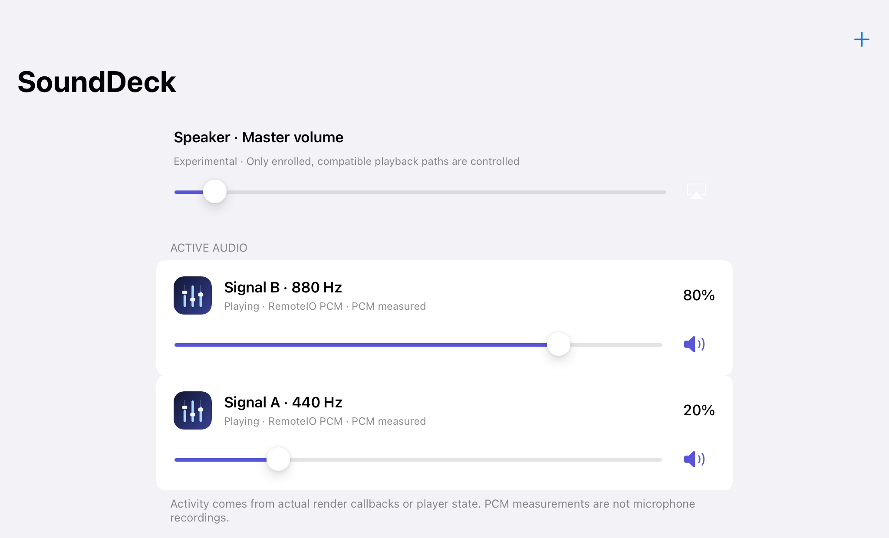
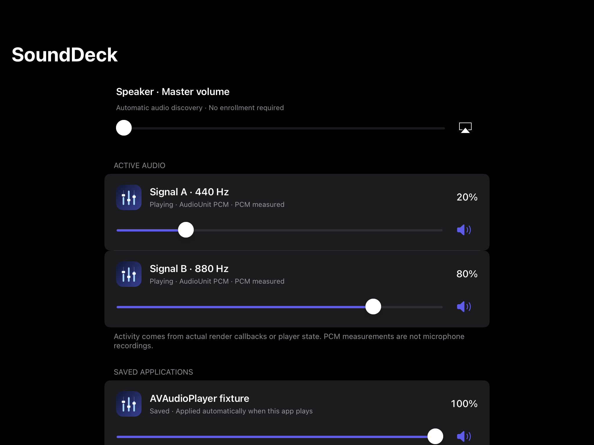
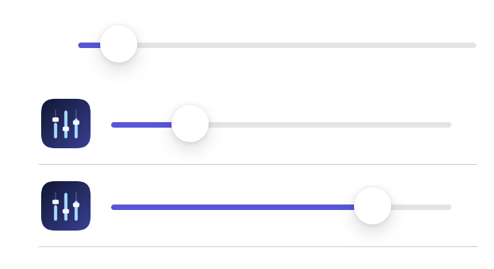

# SoundDeck

**Experimental per-app audio mixer for rootless-jailbroken iPads.** SoundDeck discovers participating apps automatically and applies each app's saved 0–100% gain or mute to supported audio pipelines. It includes a native UIKit dashboard and an expandable Control Center mixer.

> **Experimental compatibility.** A broad injection filter makes automatic discovery possible, but not every app exposes a controllable output. Numeric tests verify several real adapters on one iPad; they do not certify every App Store app or replace human listening and route testing. See [the compatibility matrix](docs/COMPATIBILITY.md) and [device evidence](docs/TESTING.md).



<details><summary>Dark appearance</summary>

</details>



## Verified on-device

- Per-app live discovery without enrollment; gains persist by bundle ID.
- Independent RemoteIO/AudioUnit PCM attenuation and mute, measured with two simultaneous signal fixtures and independent post-render observers.
- AudioQueue, AVPlayer, AVAudioPlayer and AVSampleBufferAudioRenderer adapter controls, including host-volume changes and mute, verified through real native volume parameters.
- AVAudioEngine PCM gain, checked against an independent post-render observer.
- WebKit GPU-process attribution and control for the fixture's Web Audio PCM and HTML media/AVPlayer paths.
- Five non-WebKit fixture adapters running concurrently; service-loss watchdog, bypass, upgrade and uninstall recovery.
- Control Center app sliders, media master-volume setter, persistence, capture and dashboard light/dark accessibility/layout checks.
- Tap the master speaker for Bypass/Enable, Reset volumes, Control Center add/remove and Diagnostics; these recovery actions were exercised on-device.
- Service discovery was optimized to resolve only fresh audio clients; the UI now tolerates scheduler delay instead of dropping active rows.

Test device: **iPad 6th generation / iPad7,5 / A10 arm64 / iPadOS 17.7.8 (21H440) / palera1n rootless / Procursus / ElleKit 1.2**. The package is arm64-only. Other hardware, OS versions, apps and routes need their own validation. Numeric adapter checks are not acoustic-output measurement or human listening confirmation.

## Install

Install the normal package `com.alsinas.sounddeck_0.2.2_iphoneos-arm64.deb` from the [experimental release](https://github.com/repos1tory/SoundDeck/releases/tag/v0.2.2-experimental.1) or the [repos1tory package index](https://repos1tory.github.io/) using Sileo/Zebra, or:

```sh
sudo dpkg -i com.alsinas.sounddeck_0.2.2_iphoneos-arm64.deb
```

Requires a rootless ElleKit jailbreak, CCSupport, iPadOS 15 or later, and an arm64 device. The package adds SoundDeck to the CCSupport module layout when possible. If it does not appear, restart SpringBoard or add SoundDeck in Control Center settings. `sdctl cc-install` and `sdctl cc-remove` manage only SoundDeck's module entry.

Open SoundDeck or Control Center. Playing apps appear automatically when SoundDeck observes an active supported output; **there is no enrollment step**. Each row is only an app icon and slider; set a slider to zero to mute. The master row controls system media volume, not per-app gain. Recording, calls and VoiceProcessingIO paths are excluded. Restart an already-running app after installing/upgrading so it loads the new tweak.

The optional `com.alsinas.sounddeck.tests_0.2.2_iphoneos-arm64.deb` contains quiet 440/880 Hz and framework fixtures. A freely licensed 45-second stock piano MP3 and minimal Safari test page are in [`Tests/assets`](Tests/assets/README.md); they are not installed by either package. Install fixtures only for QA; launch them explicitly and stop them after testing. They are not production app rows.

## Build and test locally

Requires a jailbroken arm64 build device with local Clang/Clang++, an iOS SDK, ldid, dpkg-deb, ElleKit and CCSupport. This project was built and signed on the test iPad; the SDK and jailbreak libraries are not included.

```sh
git clone https://github.com/repos1tory/SoundDeck.git
cd SoundDeck
export SDK=/var/jb/usr/share/SDKs/iPhoneOS.sdk
bash build.sh
python3 Tools/validate-package.py packages/com.alsinas.sounddeck_0.2.2_iphoneos-arm64.deb
```

For QA-only fixtures and scripted hooks:

```sh
bash build.sh --tests
python3 Tests/run-unit.py
sudo dpkg -i packages/com.alsinas.sounddeck_0.2.2_qa_iphoneos-arm64.deb \
  packages/com.alsinas.sounddeck.tests_0.2.2_iphoneos-arm64.deb
python3 Tests/run-device.py
python3 Tests/run-media.py
python3 Tests/run-web.py
python3 Tests/run-ui.py
```

`Tests/run-lifecycle.py` intentionally stops/removes/reinstalls only SoundDeck to validate recovery; read its source before running. Build prerequisites and safety notes are in [BUILDING.md](docs/BUILDING.md). The normal package excludes scripted QA controls.

## Recovery and removal

```sh
sdctl disable                    # unity gain and restore requested playback options
sudo apt remove com.alsinas.sounddeck.tests com.alsinas.sounddeck
```

Uninstall removes SoundDeck's Control Center entry, preserves preferences intentionally, and restores stock behavior for new processes. Existing processes keep mapped tweak code until restarted; bypass/watchdog returns supported PCM paths to unity. If the jailbreak is inactive, injection is absent and audio is stock; the `/var/jb` application may not launch until the jailbreak returns. Emergency recovery is documented in [TROUBLESHOOTING.md](docs/TROUBLESHOOTING.md).

## Architecture and limitations

The tweak observes active app audio paths, applies PCM attenuation or framework-native per-object volume, and reports fresh activity to the local service. WebKit subprocesses are separately injected and attributed to their host app through coalition identity when unambiguous. Unknown/ambiguous owners are not offered as controllable app rows. No recording, network service, analytics, cloud dependency, song metadata or media content inspection is used.

SoundDeck does not provide a universal iOS per-process hardware volume API. Apps may use unwrapped graphs, remote rendering, protected output or private pipelines that are not covered by tested adapters. It also does not suppress app/system interruptions: starting Safari while Music was playing stopped Music in live testing, even with a trial category-mix override. That override was reverted; SoundDeck controls gains, not a PC-style guarantee that every app keeps playing. Human listening, Podcasts/Photos/TV/Books/Files, headphones/Bluetooth/AirPlay transitions, calls/Siri, physical touch/VoiceOver review, portrait layout and multi-hour endurance remain unverified. A research report on optional PC-style concurrency is in [docs/research](docs/research/pc-style-concurrency-feasibility.md); 0.2.2 does not ship forced concurrency. The release stays explicitly **experimental**. See [architecture](docs/ARCHITECTURE.md), [compatibility](docs/COMPATIBILITY.md), [testing](docs/TESTING.md), [MIT license](LICENSE) and [third-party notices](THIRD_PARTY_NOTICES.md).
